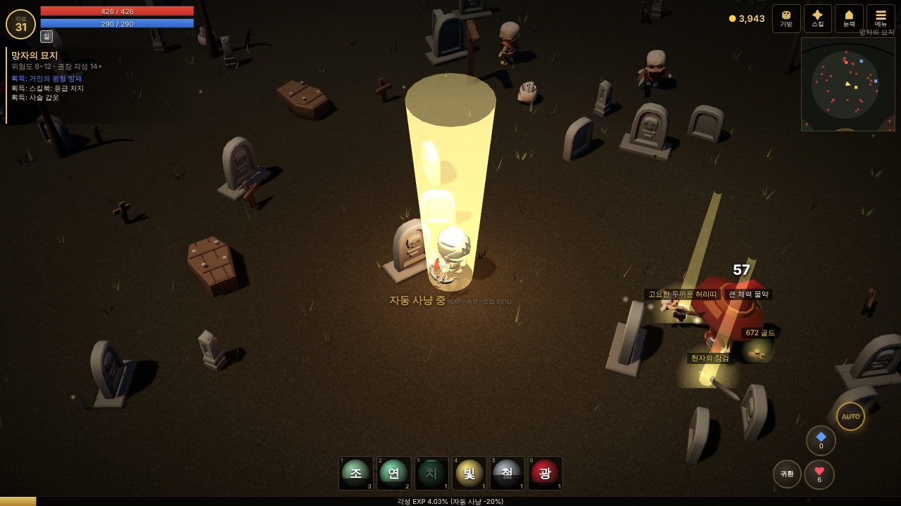

# 잿빛 연대기 (Ashen Chronicle)

어두운 판타지 배경의 쿼터뷰 웹 RPG. **레벨이 없다** — 싸운 방식대로 스탯이 오르고, 스킬은 주운 스킬북으로 배워 쓸수록 강해진다.

- 기획서: [`docs/GDD.md`](docs/GDD.md)
- PC(마우스·키보드) · 모바일(가로, 가상 조이스틱) 모두 지원 · 싱글 플레이 · 브라우저 자동 저장



## 실행

```
npm start        # http://localhost:5173
```

빌드 단계 없음. 정적 파일이므로 GitHub Pages 등에 그대로 올리면 된다. (ES 모듈이라 `index.html`을 파일로 직접 열면 안 된다.)

## 조작

| PC | 모바일 |
|---|---|
| 좌클릭: 이동 / 몬스터 공격 (누르고 끌면 계속 이동) · WASD 이동 | 왼쪽 조이스틱 |
| Space: 가까운 적 공격 · 1~6: 스킬 · Q/E: 물약 | 오른쪽 ⚔ 버튼 · 퀵슬롯 · 물약 버튼 |
| F: 자동 사냥 · R: 귀환 · I/K/C/M: 가방/스킬/능력/메뉴 · 휠: 줌 | AUTO · 귀환 · 상단 버튼 · 두 손가락 줌 |

## 점검

```
npm test         # 성장 · 스킬 · 드랍 · 사망 · 장착 로직 테스트
```

## 구조

| 경로 | 내용 |
|---|---|
| `src/data/` | 수치 · 스킬 · 아이템 · 몬스터 · 지역 (콘텐츠는 여기만 고치면 된다) |
| `src/game/` | 화면과 무관한 규칙: 각성(행동 성장) · 스킬 숙련 · 아이템 생성 · 드랍 · 가방 |
| `src/engine/` | three.js 렌더러 · 지형 · 소품 배치 · 모델 로딩 |
| `src/world/` | 월드 시뮬레이션: 조작 · 몬스터 AI · 전투 · 스킬 효과 · 자동 사냥 · 사망 |
| `src/ui/` | HUD · 창(가방/스킬/능력/상점/메뉴) |
| `assets/flare/` | Flare: Empyrean Campaign 2D 그림, CC-BY-SA 3.0 ([라이선스](assets/LICENSES.md)) |
| `tools/` | 개발 서버 · 테스트 · 에셋 변환 |
